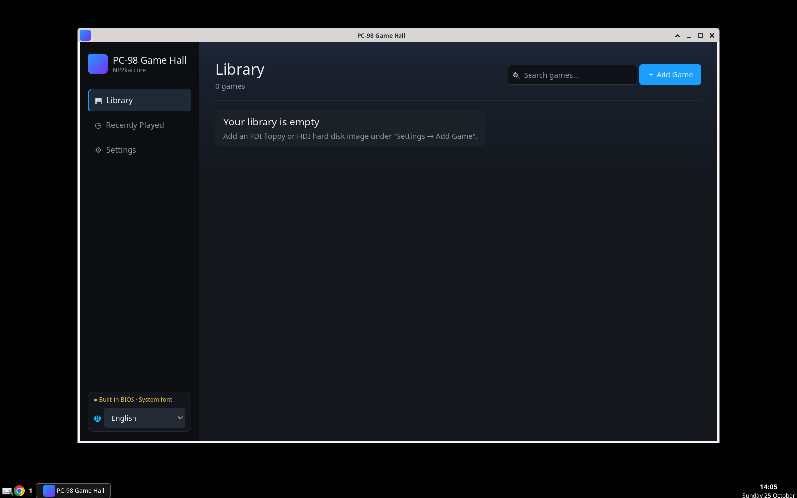

# PC-98 Game Hall

**English** | [简体中文](README_zh.md)

A modern, cross-platform frontend, launcher and emulator for retro Japanese **NEC PC-98** games.
It is built on **Godot 4.7** and wraps the **NP2kai** (Neko Project II kai) libretro core.



> PC-98 Game Hall ships **no** BIOS, font ROM or game images. Use only files you legally own.

## Features

- **Game library UI** inspired by Steam and Epic, with cover art (generated gradient covers or your own images), search, categories, "Recently Played" and play time.
- **4 UI languages:** English (default on first launch), 简体中文, 繁體中文 and 日本語. You can switch at any time without a restart, and your choice is remembered.
- **Alt+Enter fullscreen** that keeps the aspect ratio (4:3, native/square pixels, or integer scaling) with black borders. The window's maximize button and a double-click on the title bar do the same.
- **Recursive library auto-scan:**
  - Point it at one folder. Top-level folders become **categories**.
  - A folder that holds only disk images becomes one **multi-disk game**, with an in-game disk-swap menu.
  - It handles thousands of games, and missing files are flagged instead of crashing.
- **In-game PC-98 bus mouse:** the system cursor is captured while you play, and sensitivity is adjustable. Touch-mouse and on-screen pad are available on Android.
- **No BIOS required.** Like NP2, a built-in compatible BIOS and a kanji font generated from a system font let most floppy and HDD games boot without real ROMs. Real BIOS files are still supported for best compatibility.
- **Portable mode:** on Windows and Linux, all settings and data live in a `data` folder next to the program. Copy the folder to move everything to another machine or a USB stick.
- **Windows, Linux and Android** builds.
- **Crash protection:** errors in the emulator core stop emulation and show a message instead of taking down the app.

## Download

Get the latest packages from the [**Releases**](https://github.com/djamsrkwmmw-eng/PC98GameHall/releases) page:

| File | What it is |
|---|---|
| `PC98_Windows.zip` | Windows 10/11 x64. Unzip and run `PC98GameHall.exe`. |
| `PC98_Linux.tar.gz` | Linux x86_64 (X11). Extract and run `./PC98GameHall.x86_64`. |
| `PC98_Android.apk` | Android 7.0+ on arm64-v8a (almost every modern phone or tablet). |
| `PC98_Android_x86_64.apk` | Android x86_64 (emulators and some Chromebooks). |
| `PC98_Godot_Project.zip` | The full Godot 4.7 project (the same content as this repository). |

On Windows and Linux, keep all files of the package together. The UI and scripts are embedded in the executable, so there is no separate `.pck`.
The renderer is Godot "Compatibility" (OpenGL 3.3 / OpenGL ES 3.0).

## How to use

1. Start the program. The UI opens in English; change the language with the 🌐 selector at the bottom of the sidebar or under **Settings → Interface Language**.
2. Add games:
   - **One at a time:** go to **Settings → Add Game** and pick an `HDI` hard-disk image, or one or two floppy images (`FDI`, `D88`, `HDM`, …) for FDD1/FDD2. A cover image is optional.
   - **A whole collection:** set **Settings → Library folder**. The folder is scanned recursively (and again on each start, if enabled). Images are used where they are and never copied.
     ```
     Games/
     ├─ Some Game.hdi          → 1 game (uncategorized)
     └─ RPG/                   → category "RPG"
        ├─ Another Game.fdi    → 1 game
        └─ Multi Disk Game/    → 1 multi-disk game (Disk1, Disk2, … in natural order)
     ```
3. Click a game, then **Play**.
4. In game:
   - **Esc / F12:** opens the menu (pause, disk swap, font, mouse, reset, quit).
   - **Alt+Enter:** toggles fullscreen.
   - On **Android**, use the **Import** tab to copy BIOS files and disk images into the app. The on-screen pad and touch mouse can be switched in Settings.

### BIOS (optional)

No BIOS is needed to start playing. A yellow "● Built-in BIOS" indicator shows that the built-in compatible BIOS is in use.

For the best compatibility, put **your own** dumped files in a folder and select it under **Settings → BIOS Folder**:

- `bios.rom`, `itf.rom` and `sound.rom`
- optionally `FONT.ROM` / `font.bmp` and the `2608_*.wav` rhythm samples

Without a font ROM, a kanji font is generated from a system Japanese/CJK font (for example MS Gothic or Noto Sans CJK).

The Chinese guide [README_zh.md](README_zh.md) covers every option in detail: fonts, scan rules, controls, the data location, Android and Linux.

## Building from the Godot project

No C++ toolchain is needed. The `PC98Emulator` GDExtension and the NP2kai core are included as **prebuilt binaries** in `addons/pc98/bin/` for Windows x64, Linux x86_64 and Android arm64/x86_64.

1. Install **Godot 4.7.2-stable** (standard build, not .NET).
2. Clone this repository and import `project.godot` in the Project Manager. Press **F5** to run.
3. To export:
   - Install the official 4.7.2 export templates (**Editor → Manage Export Templates → Download and Install**).
   - Open **Project → Export…**, choose **Windows Desktop**, **Linux** or **Android**, then **Export Project**.
   - The presets use `embed_pck=true`.
4. Android signing: the preset contains no keystore or passwords. Provide them through environment variables:
   ```bash
   export GODOT_ANDROID_KEYSTORE_RELEASE_PATH=/path/to/your.keystore
   export GODOT_ANDROID_KEYSTORE_RELEASE_USER=your_alias
   export GODOT_ANDROID_KEYSTORE_RELEASE_PASSWORD=your_password
   ```

Exports made with the official templates are larger than the release packages, which use size-optimized custom templates. They work the same way.

## Platforms

| Platform | Status |
|---|---|
| Windows 10/11 x64 | Supported (primary target) |
| Linux x86_64 (X11) | Supported |
| Android 7.0+ arm64-v8a / x86_64 | Supported (touch UI, import page, on-screen pad) |
| macOS / iOS / Web | Not supported (no prebuilt core/plugin) |

## License

- The project's own code and assets are released under the [MIT License](LICENSE), © 2026 djamsrkwmmw-eng.
- Bundled third-party components keep their own licenses; see [NOTICE](NOTICE) and [THIRD_PARTY_LICENSES/](THIRD_PARTY_LICENSES/):
  - [NP2kai](https://github.com/AZO234/NP2kai): MIT, plus per-component licenses. The fmgen module allows free redistribution, but commercial use needs the author's permission.
  - [Godot Engine](https://godotengine.org): MIT.
  - godot-cpp: MIT.
  - stb_truetype: MIT / Public Domain.
- "PC-98" is a trademark of NEC. This project is not affiliated with NEC.
